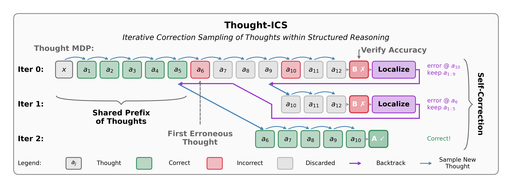
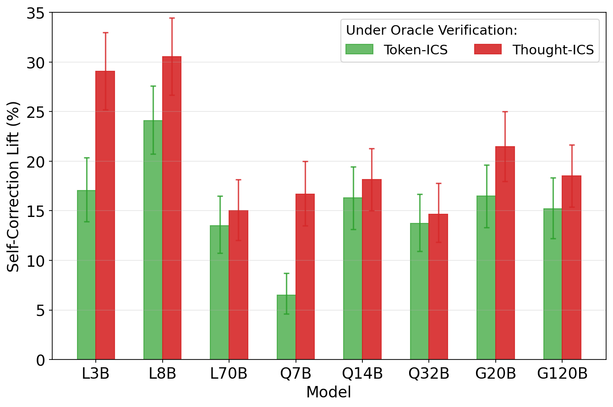
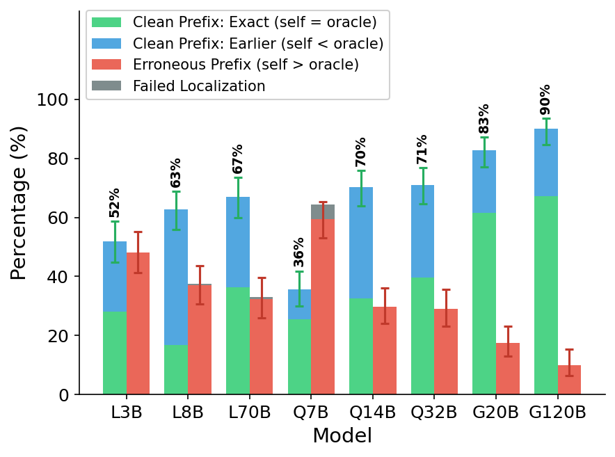
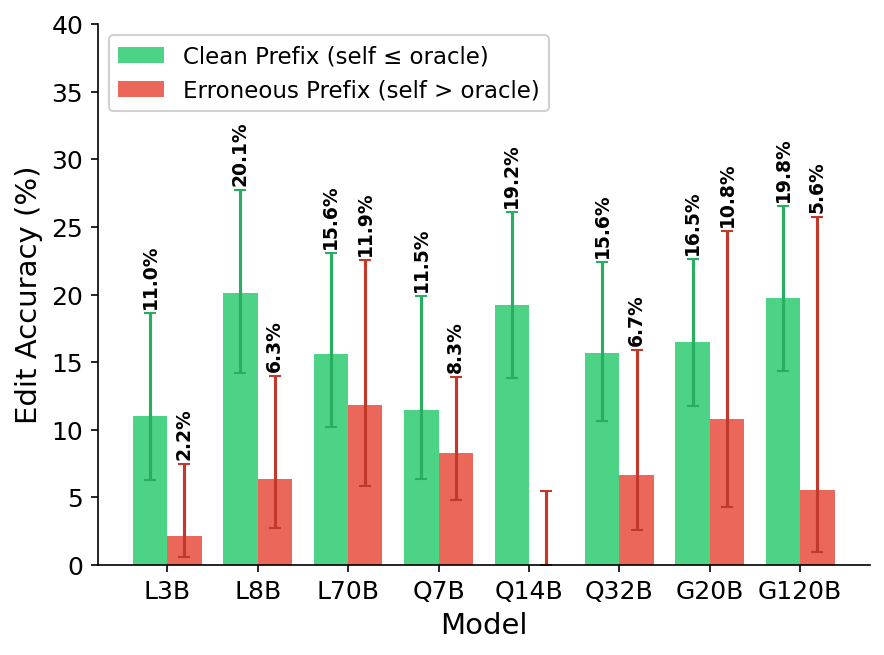
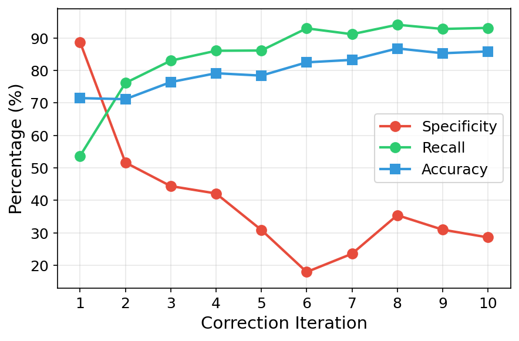
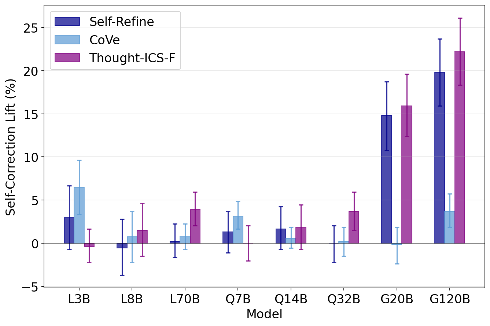

# Thought-ICS: Structure Enables Effective Self-Localization of Errors in LLMs

[](https://arxiv.org/abs/2602.02416)
[](LICENSE)

**Iterative Correction Sampling of Thoughts (Thought-ICS)** is a framework for studying
self-correction in language models. The model generates its reasoning *thought by thought*, then
localizes the first erroneous thought, and the system backtracks to resample from the last correct point.

> **TL;DR.** Language models can explicitly self-localize errors in incorrect reasoning when it is
> structured as discrete, semantically coherent thought steps, enabling effective self-correction
> through targeted backtracking and resampling.

<p align="center"></p>

This repository contains the method, the baselines and the oracle-localization pipeline. It also
contains the scripts that produce every table and figure in the paper.

## Method

**Thought-by-thought generation.** Each generation call writes one thought (one paragraph: a single
observation, calculation or deduction). The next call continues the same response from the exact
tokens so far. Some paragraphs only continue the previous thought: a displayed equation, a separator, or
content the previous thought introduced with a colon. Such a paragraph is attached to the previous
thought. Thoughts are never split after the fact.

**The correction loop.**

```
τ ← Generate(x)                                         # thought by thought
repeat up to L times
    return τ if Verify(τ)                               # v: verification reasoning
    e ← Localize the first erroneous thought in τ [given v]  # ℓ: localization reasoning
    return τ if no error is found
    τ ← Generate(τ[:e] [, v, ℓ])                         # resample from the kept prefix
return τ
```

Verification comes from one of two sources:

- an **oracle**, which tells the model when its answer is wrong but not where;
- the model itself (**self-verification**), in one of two styles:
  - *Self-Refine-style*: the model checks the response with the full response in view;
  - *CoVe-style* (the verification step of Chain-of-Verification): the model plans verification
    questions about the response, answers each one in a separate call that sees only the problem,
    and judges the response against these answers.

With **feedback**, the verification reasoning *v* is passed to the localizer, and *v* and the
localization reasoning *ℓ* are passed to the resampled completion. **Thought-ICS-F** is CoVe-style
self-verification with feedback. **Token-ICS** runs the same loop on the same first attempt, joined
into unstructured text. It localizes errors by quoting them exactly.

All methods share one protocol:

- a 32,768-token context;
- 16,384 tokens for each solution (including any kept prefix), each verification call, and each
  Self-Refine or CoVe call;
- 8,192 tokens for each localization;
- up to 10 correction attempts;
- temperature 0.5, top-p 0.9, top-k 50;
- each model's chat template.

## Results

The study covers eight models (LLaMA-3 3B/8B/70B, Qwen-2.5 7B/14B/32B, GPT-OSS 20B/120B) and six
benchmarks (AMC23, AIME, MATH-500 level 5, CommonsenseQA, GPQA, MathQA).

**Structure improves self-correction under oracle verification.** Starting from the same first
attempts, Thought-ICS achieves a higher self-correction lift than Token-ICS on every model.

<p align="center"></p>

**Structure enables precise self-localization.** We compare against a three-judge oracle. Resampling
from a clean prefix fixes 2.7× more answers than resampling from an erroneous one.

<p align="center">


</p>

**Fully autonomous self-correction.** Self-verification degrades over correction iterations, and how
reliable it is depends on the model family. Carrying verification and localization feedback through
correction improves self-correction. Thought-ICS-F matches or outperforms Self-Refine and CoVe for
all models of 14B parameters and above.

<p align="center">


</p>

## Repository structure

```
thought_ics/
  protocol.py        prompts, parsers and budgets (shared by every method)
  ics.py             engine, thought-by-thought generation, verification, Thought-ICS / Token-ICS
  baselines.py       Self-Refine and Chain-of-Verification (CoVe)
  majority_vote.py   MV@k
  benchmarks.py      the six benchmarks, frozen to the exact evaluated problems
data/benchmarks/     problem sets (GPQA: ids and hashes only, rebuilt from Hugging Face)
scripts/
  submit.sh          SLURM submission for every experiment
  report_*.py        accuracy, localization and verification reports
  oracle/            oracle localization: build batches, judge, validate, analyze
  paper/             every figure and table in the paper
tests/               CPU tests (fake engine) and golden prompt/parser regression tests
```

## Installation

```bash
conda env create -f environment.yml && conda activate thought-ics
pip install -r requirements.txt && pip install -e .
pytest                                  # CPU only
```

The runs use vLLM on NVIDIA A100 GPUs. GPQA is gated on Hugging Face. Before the first GPQA run,
accept its terms and log in with `huggingface-cli login`.

## Reproducing the paper

`scripts/submit.sh` submits one job per (model, benchmark). It sets the number of GPUs for each model
and reads cluster settings from the environment (`PARTITION`, `CONDA_ENV`, ...). Results go to `results/`.

```bash
scripts/submit.sh oracle all all          # Thought-ICS and Token-ICS, oracle verification (Sec. 4)
scripts/submit.sh mv all all              # MV@10 (App.)
scripts/submit.sh self all all            # Thought-ICS, Self-Refine-style self-verification (Sec. 5.1)
# after the `self` runs finish (they provide the first attempts shared by all of the following):
scripts/submit.sh self-fb all all         # ... with feedback (Sec. 5.2, App.)
scripts/submit.sh self-cove all all       # Thought-ICS, CoVe-style self-verification (Sec. 5.2)
scripts/submit.sh thought-ics-f all all   # Thought-ICS-F: CoVe-style, with feedback (Sec. 5.2-5.3)
scripts/submit.sh self-refine all all     # Self-Refine (Sec. 5.3)
scripts/submit.sh cove all all            # CoVe (Sec. 5.3)
```

You can also start a single run directly, for example
`python -m thought_ics.ics --model gptoss20b --dataset aime --verify self --method thought`. Add
`--limit 5 --max-ics-iterations 2` for a smoke test.

CoVe was proposed as a single verify-and-revise pass. To give every method the same number of
correction iterations, the CoVe baseline repeats this pass on the current solution up to 10 times
and stops once a revision leaves the answer unchanged.

**Oracle localization labels** (Sec. 4.2) come from `scripts/oracle/pipeline.sh`. It does four things:

1. builds labeling batches from the oracle-verified runs;
2. prints the task for any judge model;
3. validates the labels;
4. computes the consensus and the clean/erroneous-prefix analysis.

See `scripts/oracle/README.md` for details.

**Reports, figures and tables:**

```bash
python scripts/report_oracle_verified.py     # Sec. 4: accuracy, lift, localization mechanics
python scripts/report_self_verified.py       # Sec. 5: exits and verifier recall / specificity
python scripts/oracle/paired_stats.py results/oracle/part1 results/oracle/part2
python scripts/paper/make_figures.py         # -> paper_assets/figures
python scripts/paper/make_tables.py          # -> paper_assets/tables
python scripts/paper/tree_example.py         # appendix tree example
```

Math benchmarks are graded by mathematical equivalence (Math-Verify), and multiple-choice benchmarks
by answer letter.

**Parsing.** A verdict is read from the last `\boxed{YES}` / `\boxed{NO}`, or else from a final
YES or NO at the end of the reply. A reply with neither is continued with `Final verdict: \boxed{`
and a few greedy tokens; if that gives no verdict either, it counts as NO. A step number is read from
the last `\boxed{N}`, else the last "Step N", else a final line that is only a number. A
localization with no valid step number is a failed localization and uses up the correction attempt.

## Run outputs

Each run directory `results/<model>_<benchmark>_<setting>_<timestamp>/` contains three files
(`<setting>`: `oracle`, `self`, `self-fb`, `self-cove`, `thought-ics-f`, `self-refine`, `cove`, `mv10`):

- `config.json`: every setting, and the git commit;
- `summary.json`;
- `<method>_results.jsonl`: one record per problem.

Each record holds, for every iteration:

- the generation: thoughts or solution, answer, token counts, stop reason;
- the verification: prompt, full response, verdict;
- the localization: prompt, full response, parsed step or quote, kept prefix, and any feedback carried
  forward.

## Citation

```bibtex
@misc{samanta2026structureenableseffectiveselflocalization,
      title={Structure Enables Effective Self-Localization of Errors in LLMs},
      author={Ankur Samanta and Akshayaa Magesh and Ayush Jain and Kavosh Asadi and Youliang Yu and Daniel Jiang and Boris Vidolov and Kaveh Hassani and Paul Sajda and Jalaj Bhandari and Yonathan Efroni},
      year={2026},
      eprint={2602.02416},
      archivePrefix={arXiv},
      primaryClass={cs.AI},
      url={https://arxiv.org/abs/2602.02416},
}
```

## License

Released under the [MIT License](LICENSE).
